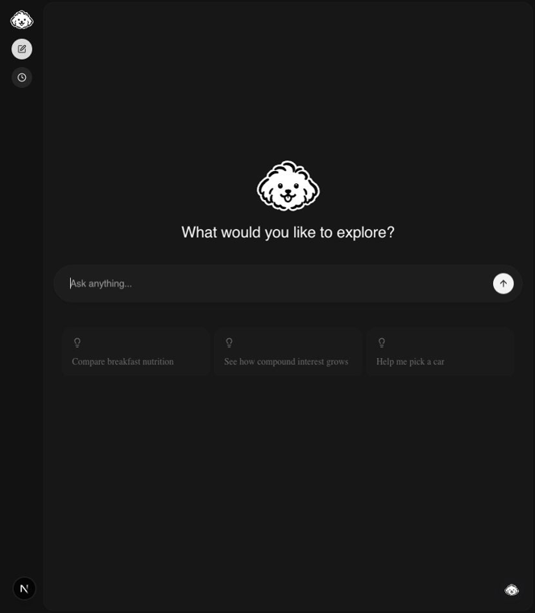

# OpenUI × use-ai generative UI chat

A local prototype: a use-ai chat whose model answers with OpenUI Lang through a `render_ui` tool, rendered inline in the chat. Generated UIs can read and write invented field-service demo data (jobs, customers, invoices, tasks) through OpenUI `Query`/`Mutation`.

**Model: DeepSeek.** DeepSeek replaces Claude Haiku from the design. The design's model choice is superseded; nothing else in it changes. The Haiku results further down are kept as history.

## Demo

Recorded with an earlier version of this prototype (OpenUI's own chat shell, before use-ai).

[](https://github.com/KakkoiDev/openui-poc/blob/main/docs/media/openui-demo.mp4)

## Run with DeepSeek

Requires Node.js 20.9+ and npm. The key is read from the shell environment only. Never put it in a file, a commit, a log or a command line.

1. Install without OpenUI's install telemetry:
   ```sh
   OPENUI_TELEMETRY_DISABLED=1 npm install
   ```
2. Put the key in the environment without echoing it or writing it to shell history:
   ```sh
   read -rs DEEPSEEK_API_KEY && export DEEPSEEK_API_KEY
   ```
3. Optional: pick the model (default `deepseek-chat`):
   ```sh
   export DEEPSEEK_MODEL=deepseek-reasoner
   ```
4. Reset the demo data, then start both processes (Next on :3000, use-ai server on :8081):
   ```sh
   npm run demo:reset
   npm run dev
   ```
5. Open http://localhost:3000. The `[ai]` log line shows `model: deepseek-chat`.
6. When done: stop with Ctrl-C, then `unset DEEPSEEK_API_KEY`.

The server refuses to start without `DEEPSEEK_API_KEY` (or mock mode). The use-ai server reads no env file.

### Run offline (mock model)

```sh
npm run demo:reset
npm run dev:mock
```

`DEMO_MOCK_MODEL=1` swaps DeepSeek for a scripted model (`server/model.ts`). Every turn streams one sentence, a `render_ui` call with a fixed dashboard (bar chart from `sales_summary`, table from `list_jobs`, a button that runs `create_followup_task`), then a closing sentence. Nothing leaves the machine. This is how the app was verified end to end; DeepSeek itself has not been called yet.

## Try it

From design section 10.2. Run `npm run demo:reset` before each run.

| # | Prompt | Pass condition |
|---|---|---|
| E1 | "Compare monthly revenue for 3 products as a line chart, sample data" | A line chart with 3 series. Still there after a reload |
| E2 | "Quarterly sales report with one tab per region, each with a bar chart and a table" | At least 2 tabs, each with a bar chart and a table |
| E3 | "Help me plan a team offsite; ask for date, budget, headcount with a form" | A 3-field form. Submitting adds a user message with the button label; the next answer quotes budget and headcount |
| E4 | "Show this month's scheduled jobs by assignee as a bar chart, with a table of the jobs below" | `Query("list_jobs", ...)` or `Query("sales_summary", ...)` in the program; rows match `data/demo-db.json` |
| E5 | "Add a button on each unpaid invoice to create a follow-up task due next Friday" | Clicking a button writes one task to `data/demo-db.json` with that invoice's job id; nothing is written before the click |
| E6 | "Make that a pie chart" (after E1) | A pie chart with E1's products and totals |

## How it works

- `server/index.mts`: use-ai server (`UseAIServer` + `AISDKAgent`, socket.io on :8081, CORS `http://localhost:3000`). The system prompt is OpenUI's generated library prompt, plus the demo data tool descriptors, plus the channel rules in `src/genui/server.ts`. `maxOutputTokens` 8192.
- `server/model.ts`: DeepSeek via `@ai-sdk/deepseek`, or the mock model.
- `server/noTelemetry.ts`: imported first; see [Telemetry](#telemetry).
- `src/components/GenUIChat.tsx`: `UseAIProvider` + `UseAIChat` with a custom `Message` slot. Client-only (`next/dynamic`, `ssr: false`), light theme only.
- `src/genui/`: `createGenUI({ library, toolProvider })` returns the `render_ui` client tool (validates the program with OpenUI's parser and returns the errors to the model) and `GenUIMessage` (renders each `render_ui` call under the message text, while streaming and after reload).
- `src/demo/fieldservice/` + `src/app/api/demo/[tool]/route.ts`: the demo data tools over a JSON file. `data/demo-seed.json` is committed; `data/demo-db.json` is the gitignored working copy.
- Form submits go back to the model as the button label plus the form values as hidden text. `@OpenUrl` is dropped.

## What is sent to DeepSeek

Measured with the mock model by recording every model call (prompt and tools) during a chat turn. Each model request to `https://api.deepseek.com/v1` carries:

1. **System prompt**, about 48.9k characters, the same on every request:
   - OpenUI's generated component-library prompt (component signatures, OpenUI Lang syntax, generic examples). Generated from the installed `@openuidev/react-ui` package.
   - Name, description and JSON schemas of the 5 demo data tools (`list_jobs`, `sales_summary`, `list_invoices`, `create_followup_task`, `update_job_status`).
   - The 6 channel rules in `src/genui/server.ts`.
2. **The whole conversation so far**:
   - What the user typed.
   - Values the user typed into generated forms and submitted (sent as hidden text).
   - Earlier assistant text and every earlier `render_ui` program.
   - `render_ui` results (`success`, or the parser errors).
3. **One tool definition**: `render_ui` with `{ program: string }`.

Not sent:

- Demo data rows. `Query`/`Mutation` run in the browser against `/api/demo/*`; their results never go to the model. A row reaches the model only if the user types it or submits it in a form. All demo data is invented.
- use-ai's "Current application state" message. The app registers no prompt state, and none appeared in the recorded calls.
- Anything from the host: no files, environment, repository content or internal URLs. The prompt and fixtures contain no company or customer names.

DeepSeek also sees the API key and the caller's IP address, as with any API call.

## Telemetry

- **use-ai server / Langfuse.** Sends prompts and outputs when `LANGFUSE_PUBLIC_KEY` and `LANGFUSE_SECRET_KEY` are both set. `server/noTelemetry.ts` deletes every `LANGFUSE_*` variable before the server loads.
- **OpenUI runtime telemetry.** Opt-in only. `noTelemetry.ts` deletes `OPENUI_RUNTIME_TELEMETRY_ENABLED` and sets `OPENUI_TELEMETRY_DISABLED=1`.
- **Next.js.** `NEXT_TELEMETRY_DISABLED=1` is set in the server process. For the web process, run `npx next telemetry disable` once.
- **OpenUI install telemetry.** The `@openuidev/lang-core` `postinstall` sends an install event (no prompts). Install with `OPENUI_TELEMETRY_DISABLED=1`.

## Checks

```sh
npm test           # vitest: genui, demo data tools, model factory, telemetry
npm run typecheck
npm run build
```

`npm run generate` refreshes `src/generated/spec.json` from the installed library.

## DeepSeek measurements

To fill on the machine with the key. Design section 10.3: one row per prompt per run, 3 runs.

| Run | Prompt | First-call success | Self-repairs | Lead-in | Closing | Saved after reload | Truncated | Input / cache-read / output tokens | Time to first rendered node |
| --- | --- | --- | --- | --- | --- | --- | --- | --- | --- |
| 1 | E1 | | | | | | | | |
| 1 | E2 | | | | | | | | |
| 1 | E3 | | | | | | | | |
| 1 | E4 | | | | | | | | |
| 1 | E5 | | | | | | | | |
| 1 | E6 | | | | | | | | |

## Haiku observations (history)

Measured 2026-10-30 with the previous version of this app: OpenUI Lang in the reply text, Claude Haiku via the Claude Code CLI 2.1.314. Not comparable with the current `render_ui` tool design.

| Setting | Replies | First byte | Full reply | Replies with validation errors |
| --- | --- | --- | --- | --- |
| Thinking off | 9 | 1.1-2.6 s | 3.1-8.1 s | 1 of 9 |
| Thinking on | 6 | 17.8-66.8 s | 20.0-71.6 s | 0 of 6 |

- The one invalid reply nested `TabItem` content in an extra array, so the tabs rendered empty.

## Need fix before production ready

From design section 11, plus issues found while building. None block local use.

| # | Issue | Production direction |
|---|---|---|
| G1 | OpenUI's chat shell opens model-given `@OpenUrl` URLs with raw `window.open`: no scheme check, no `noopener` (`@openuidev/react-ui@0.18.1` `dist/index.mjs:325-331`). A `javascript:` URL ran script in the host origin in a browser probe | This app no longer uses that shell and drops `@OpenUrl`. A future handler must allow only `http(s)` and pass `noopener,noreferrer` |
| G2 | **Known POC v1 gap.** `Query`/`Mutation` run in the browser through `toolProvider` and a local route. They bypass use-ai's `destructiveHint` approval, server tool routing and tracing. A Mutation writes the JSON db with no confirmation | POC v2: a `toolProvider` callback that routes through use-ai's tool path and approval |
| G3 | Model-controlled URLs: image components load any `https:` URL on render. Markdown in text components may render images (unverified) | Host allowlist or image proxy; sanitize markdown images |
| G4 | Generated forms render inside trusted app chrome (spoofing, phishing) | Visual boundary; no secret-type inputs; prompt-injection review |
| G5 | `@openuidev/lang-core` postinstall sends an install event to PostHog | `OPENUI_TELEMETRY_DISABLED=1` in CI and docs |
| G6 | `npm audit`: 43 advisories (11 high, 21 moderate, 11 low). Highs: `zod` memory exhaustion via `@ag-ui/core` (use-ai-core, react-headless), `protobufjs` and OpenTelemetry via use-ai-server's `@opentelemetry/sdk-node`. No compatible automatic fix | Upgrade upstream packages; re-audit |
| G7 | React 19 runs against use-ai-client's `react <=18` peer through an npm override | use-ai peer range update after a compatibility test |
| G8 | The UI does not stream when the model calls `render_ui` before writing any text | use-ai client: count tool-call parts as answer content |
| G9 | Prompt cost: about 48.9k characters of system prompt on every model request. Cached only by the provider (DeepSeek caches prefixes automatically) | Smaller host-owned library |
| G10 | Form, `$binding` and `EditableTable` state is lost on reload; only submitted values persist | Persist renderer state per tool call |
| G11 | Every saved `render_ui` program and form submission is re-sent on each later turn | Trim old programs; size cap and PII review for form values |
| G12 | No auth on the use-ai server; CORS fixed to localhost | Real auth and origin config |
| G13 | Dependency churn: `react-ui` 0.x; `ai` and `@ai-sdk/deepseek` are pinned prereleases (`6.0.0-beta.116`, `2.0.0-beta.36`) to match use-ai-server | Pin exact versions; move to stable releases with use-ai |
| G14 | DeepSeek's OpenUI Lang quality is unmeasured | Fill [DeepSeek measurements](#deepseek-measurements) |
| G15 | A turn whose last step has no text is not saved; its generated UI vanishes on reload | use-ai client: save turns that contain only tool calls |
| G16 | A form in an older message can be submitted while another run is streaming | Expose run `loading` to message slots, or queue such submits |
| G17 | `/api/demo/*` accepts writes with no auth, CSRF check or rate limit. Fine only on localhost with fake data | Replaced by v2 routing (G2); real data needs the host app's API and auth |
| G18 | OpenUI's prompt preamble tells the model its entire response must be OpenUI Lang code with no markdown. The channel rules then ask for a sentence plus a `render_ui` call. The model gets conflicting instructions | Check in the measurements; if it hurts, override the preamble through `promptOptions` |
| G19 | When the model's one repair also fails, the frame renders whatever parsed and drops the rest, with no message to the user. Render errors only go to the browser console | Show a visible error state in the frame |
| G20 | The automated worker did not update the example env file at the repo root (its permissions block those files). It must list an empty `DEEPSEEK_API_KEY` and nothing else | Check it by hand before sharing |

## Attribution

Adapted from thesysdev/openui (MIT), source commit `7df27bc8eeb6fd15ac318ca7745d225a8e16e9b9`. Upstream license is retained in `LICENSE`.
